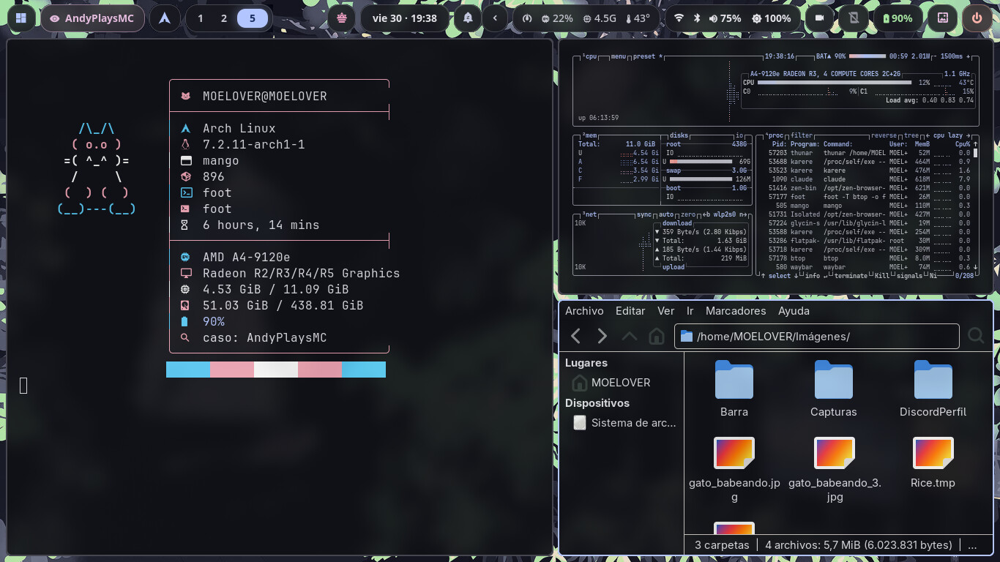
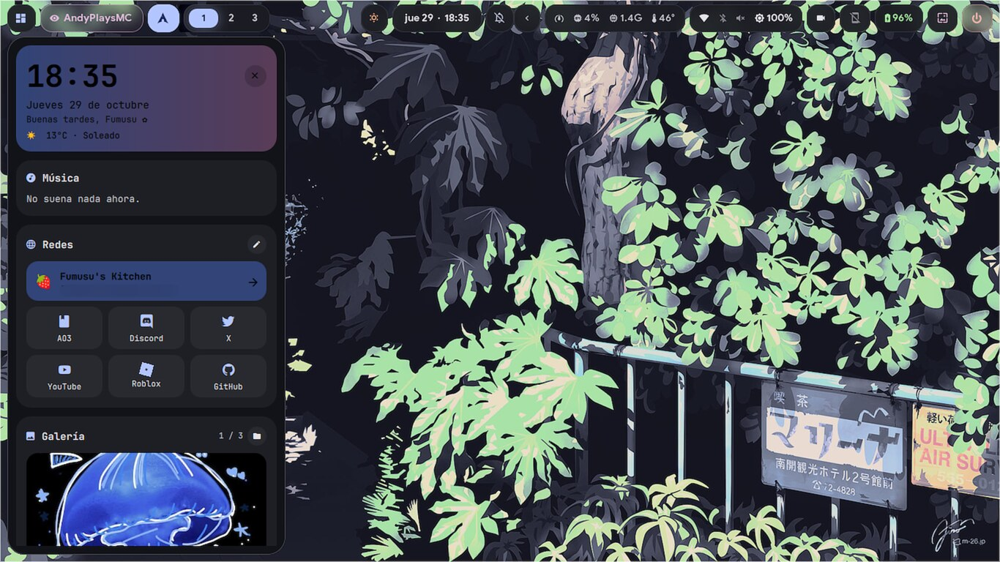

# dotfiles

mi escritorio en arch con mango. corre en una notebook con un A4-9120e de 2 núcleos, así que todo está pensado para ser liviano.




## qué hay

- **wm:** [mango](https://github.com/DreamMaoMao/mango)
- **barra:** waybar
- **barra lateral y lockscreen:** quickshell
- **notificaciones:** swaync
- **colores:** matugen, salen del wallpaper y se aplican a todo
- **terminal:** foot + starship + fastfetch
- **launcher:** fuzzel
- **archivos:** thunar y yazi
- **fuentes:** Nunito y JetBrainsMono Nerd Font
- **cursor:** Bibata Modern Ice

en `local/bin` están los scripts: panel de wifi/bluetooth/brillo (`ajustes-rapidos`), el celu con scrcpy y kde connect (`celular`, `smart-connect`), calculadora, capturas con satty, grabar pantalla o audio, selector de fondos, etc.

## instalar

```sh
git clone https://github.com/Fumusu-ao3/dotfiles
cd dotfiles
./install.sh
```

hace copia de lo que ya tengas en `~/.config` antes de pisar nada. los fondos van en `~/wallpapers`.

los links de la barra lateral se cambian en `~/.config/quickshell/sidebar/links.json` y la galería muestra lo que haya en `~/Imágenes/Barra`.

## atajos

| atajo | qué hace |
|---|---|
| `super + enter` | terminal |
| `super + d` | aplicaciones |
| `super + b` | barra lateral |
| `super + t` | elegir fondo |
| `super + shift + t` | fondo al azar |
| `super + e` | thunar |
| `super + v` | portapapeles |
| `super + c` | wifi / bluetooth / celu |
| `super + shift + s` | captura de una zona |
| `super + q` | cerrar ventana |
| `super + f1` | todos los atajos |

## créditos

arranqué desde los [dotfiles de deridray](https://github.com/deridray/dotfiles), de ahí vienen la base de mango y varias plantillas de matugen. licencia GPL-3.0 como el original.
